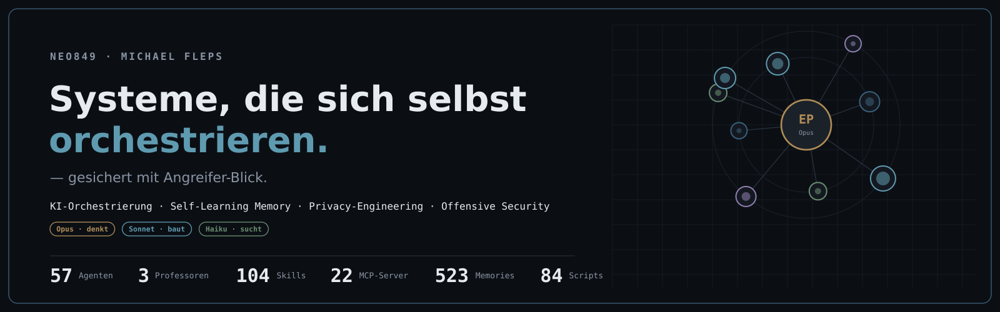

<p align="center">
  
</p>

<p align="center">
  <b>Ich baue und breche Systeme — und schütze Menschen davor.</b><br>
  <em>Offensive Security trifft selbst-gebaute KI-Infrastruktur und On-Device-Privacy.</em>
</p>

<p align="center">
  
  
  
</p>

<p align="center">
  <a href="https://priframe.com"></a>
  <a href="https://www.f3-data-solutions.com"></a>
  
  
  
  
  
</p>

<p align="center">
  <a href="#was-ich-baue">Was ich baue</a> &nbsp;·&nbsp;
  <a href="#ausgewählte-projekte">Projekte</a> &nbsp;·&nbsp;
  <a href="#tech">Tech</a>
</p>

---

Tagsüber suche ich Schwachstellen in Web-Applikationen, parallel baue ich eine stark
automatisierte KI-/Security-Infrastruktur, die diese Arbeit skaliert: Agenten-Orchestrierung,
lokale LLMs, selbst-lernendes Gedächtnis, eigene MCP-Server, Skills und reproduzierbare
Pipelines — alles auf eigenem, gehärtetem Server.

## Was ich baue

**priframe — On-Device-Gesichtsschutz.** Gesichtsredaktion, die zu 100 % im Browser auf dem
Gerät läuft. Kein Upload, kein Server-Roundtrip — Privacy by design. &nbsp;→ [priframe.com](https://priframe.com)

**Eigene KI-/Security-Infrastruktur.** Ein orchestrierter Agenten-Verbund mit Fach-"Professoren"
im Review-Loop, lokalen Modellen, einem selbst-lernenden Markdown+git-Gedächtnis, eigenen
MCP-Servern, Skills und reproduzierbaren Pipelines. Entworfen für überprüfbare, belastbare
Ergebnisse statt Black-Box-Automatik.

**Offensive Security.** Web Application Security mit Angreifer-Blick (IDOR/BOLA, Auth-Bypass,
Information Disclosure). Eigene Recon-Pipelines auf Linux; Findings methodisch verifiziert,
CVSS-bewertet, sauber dokumentiert.

## Ausgewählte Projekte

| Projekt | Worum es geht | Stack |
|---|---|---|
| [qwen-memory-agent](https://github.com/NEO849/qwen-memory-agent) | **Regress-Guard** — selbst-korrigierendes Gedächtnis für KI-Coding-Agenten: ein einmal behobener Bug kehrt nicht zurück (Qwen-Hackathon) | Python |
| [markmem](https://github.com/NEO849/markmem) | Selbst-lernendes, selbst-tunendes KI-Gedächtnis auf Markdown + git | Python |
| [agentdeck](https://github.com/NEO849/agentdeck) | Ein-Befehl-Integration einer tmux-Agenten-Sidebar in Claude Code | Shell |
| [aria-password-tester](https://github.com/NEO849/aria-password-tester) | Web-Passwortstärke-Tester: Live-Analyse, zxcvbn, Shannon-Entropie, k-Anonymity-HIBP | Python |
| [neo-portfolio](https://github.com/NEO849/neo-portfolio) | Portfolio + live betriebene OSINT-Intelligence-Suite — React-Frontend bis gehärtete FastAPI | TypeScript |

## Tech

```
Security      Web-AppSec (IDOR/BOLA, Auth, Info-Disclosure), Recon-Automation, Caido/Burp, Nuclei
KI-Systeme    Agenten-Orchestrierung, MCP-Server, lokale LLMs, selbst-lernendes Gedächtnis, Pipelines
Development   Python, TypeScript/React, Swift/SwiftUI, Kotlin
Infrastruktur Linux (gehärtet), Docker, Bash, git, Cloudflare, Tailscale
```

---

<p align="center"><em>Offen für Projekte & Zusammenarbeit — sichere KI-Automation, Privacy-Engineering, offensive Security.</em></p>
