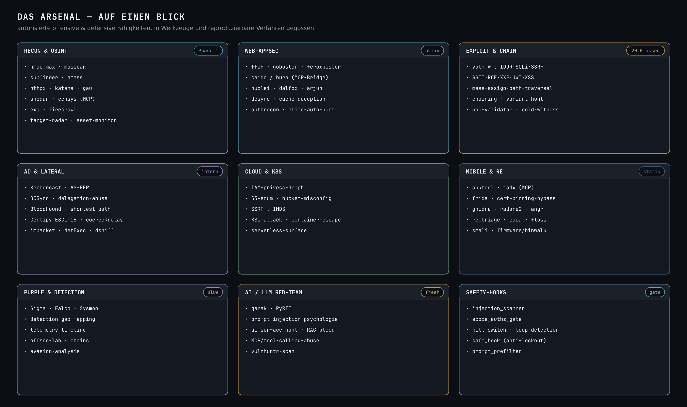
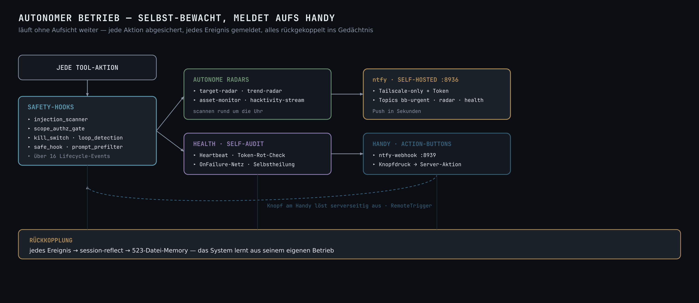
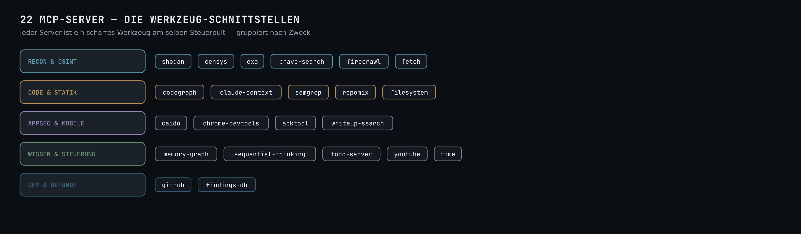

<p align="center">
  
</p>

<p align="center">
  <b>Ich baue Systeme, die sich selbst orchestrieren — und sichere sie mit Angreifer-Blick.</b><br>
  <em>Ein orchestrierter Verbund aus Spezialisten-Agenten, lokalen LLMs, selbst-lernendem Gedächtnis,<br>
  eigenen MCP-Servern, einem Offensive-Arsenal und reproduzierbaren Pipelines — auf eigenem, gehärtetem Server.</em>
</p>

<p align="center">
  
  
  
  
</p>

<p align="center">
  
  
  
  
  
  
  <a href="https://priframe.com"></a>
</p>

<p align="center">
  <a href="#das-system">System</a> &nbsp;·&nbsp;
  <a href="#die-orchestrierungs-maschine">Orchestrierung</a> &nbsp;·&nbsp;
  <a href="#das-arsenal">Arsenal</a> &nbsp;·&nbsp;
  <a href="#autonomer-betrieb">Autonomer Betrieb</a> &nbsp;·&nbsp;
  <a href="#22-mcp-server">MCP</a> &nbsp;·&nbsp;
  <a href="#das-claude-setup">Setup</a> &nbsp;·&nbsp;
  <a href="#self-learning-memory">Memory</a> &nbsp;·&nbsp;
  <a href="#produktions-pipelines">Pipelines</a> &nbsp;·&nbsp;
  <a href="#skills--commands">Skills</a> &nbsp;·&nbsp;
  <a href="#was-uns-abhebt">Abgrenzung</a> &nbsp;·&nbsp;
  <a href="#projekte">Projekte</a>
</p>

---

<a id="das-system"></a>


Ich betreibe keine Sammlung von Skripten, sondern eine **durchgehend orchestrierte KI-/Security-Plattform**
auf eigenem, gehärtetem Server — entworfen für ein Prinzip: **überprüfbare, belastbare Ergebnisse statt
Black-Box-Automatik.** Nichts gilt als „fertig", bevor es ein unabhängiger Prüfer gegengecheckt und ein
echter Lauf es bestätigt hat.

Was auf dem Server tatsächlich steht — gezählt, nicht geschätzt:

| Baustein | Umfang | Was es ist |
|---|---:|---|
| **Spezialisten-Agenten** | **57** | eigenständige Experten-Rollen (Recon, Web-AppSec, Business-Logic, Exploit-Chaining, AD-Lateral, Cloud, Mobile-RE, Validierung, Video-Produktion, Business/Legal …) |
| **Fach-Professoren** | **3** | Protokoll-/RFC-Korrektheit, Mathematik/Krypto, Computer-Vision-Modelle — im adversarialen Review-Loop |
| **Modulare Skills** | **104** | wiederverwendbare Verfahren (20 Vuln-Klassen, Recon-, Hunt-, Design-, Orchestrierungs-Playbooks) |
| **Slash-Commands** | **22** | Ein-Wort-Auslöser für ganze Abläufe (`/submit-gate`, `/new-target`, `/tailscale`, Memory-Familie …) |
| **MCP-Server** | **22** | Werkzeug-Schnittstellen (Shodan, Censys, Caido, CodeGraph, Semgrep, Repomix, apktool …) |
| **Safety-Hooks** | **11** | Sicherungen über **16 Lifecycle-Events** (Injection-Scan, Scope-Gate, Kill-Switch, Loop-Guard) |
| **Self-Learning Memory** | **523** | versioniertes Markdown-Gedächtnis mit semantischem Abruf — lernt aus jeder Session |
| **Automations-Skripte** | **84** | Hooks, Pipelines, Radars, Health-Heartbeats, Reflektions-Schleifen |

**Modell-Disziplin:** schweres Denken, Bauen und Suchen laufen auf passend gewählten Modellen —
*Opus denkt · Sonnet baut · Haiku sucht* — statt alles teuer über ein Modell zu jagen.

---

<a id="die-orchestrierungs-maschine"></a>


Der Kern ist nicht *ein* Agent, sondern ein **Dirigent über vielen Spezialisten**. Jede nicht-triviale
Aufgabe durchläuft denselben Vier-Phasen-Loop — **Zerlegen → Zuweisen → Parallel → Härten** — und erst
danach kommt Live-Verify und das Gedächtnis. Kein Agent ruft von sich aus den nächsten; die Verkettung
führt der Showrunner anhand maschinen-lesbarer Übergaben.

<div align="center">
  
  <br><sub>Vektor-Download: <a href="assets/orchestrierung.svg">orchestrierung.svg</a></sub>
</div>

**Das entscheidende Detail — `maker ≠ checker`:** Wer etwas baut, darf es nie selbst abnehmen. Ein
unabhängiges QC-Gate (`skeptical-validator`, `cold-witness`, `video-qc-pruefer`) prüft **nur fremde Arbeit**
und versucht aktiv, das Ergebnis zu widerlegen. Das tötet die teuerste Fehlerklasse: das zu früh geglaubte
„passt schon".

---

<a id="das-arsenal"></a>


Autorisierte offensive **und** defensive Fähigkeiten, in echte Werkzeuge und reproduzierbare Verfahren
gegossen — nicht als Tool-Liste, sondern als geführte Playbooks. Alle offensiven Aktivitäten laufen
**read-only-first**, gegen autorisierte Ziele, mit Safety-Gates vor jedem eingreifenden Schritt.

<div align="center">
  
  <br><sub>Vektor-Download: <a href="assets/arsenal.svg">arsenal.svg</a></sub>
</div>

- **Recon & Web-AppSec** — `nmap_max`, `nuclei`, `ffuf`/`gobuster`/`feroxbuster`, `caido` (eigene MCP-Bridge),
  `subfinder`/`amass`/`httpx`, plus Tier-1–4-Arsenal-Installer für reproduzierbare Toolchains.
- **Exploit & Chain** — **20 `vuln-*`-Skills** (IDOR, SQLi, SSRF, SSTI, RCE, XXE, JWT, XSS, Mass-Assignment,
  Path-Traversal, NoSQL, File-Upload, Open-Redirect, Subdomain-Takeover, WebSocket …), gefolgt von
  `chaining` und `variant-hunt` (eine Lücke → dieselbe Klasse überall sonst suchen).
- **AD & Lateral (Kali-advanced)** — Kerberoast / AS-REP, DCSync, BloodHound-Pfadanalyse, Certipy
  ESC1-16, Coerce→Relay→ADCS, `impacket`/`NetExec`, dsniff-AD-Relay-Rezepte.
- **Cloud, Mobile-RE, Purple** — IAM-Privesc-Graph & SSRF→IMDS; `apktool`/`frida`/`ghidra`/`re_triage`;
  Detection-Gap-Mapping (Sigma/Falco/Sysmon) im eigenen Offsec-Lab.
- **AI / LLM Red-Team** — `garak`, PyRIT, `vulnhuntr`, Prompt-Injection-Psychologie, RAG-Bleed &
  MCP-/Tool-Calling-Abuse: die frische, schnell wachsende Angriffsfläche.

---

<a id="autonomer-betrieb"></a>


Das System läuft **ohne Aufsicht weiter** — und bleibt dabei an der kurzen Leine. Jeder Tool-Aufruf passiert
zuerst ein Netz aus **Safety-Hooks**; autonome Radars scannen rund um die Uhr; relevante Ereignisse landen
über einen **self-hosted ntfy-Dienst** in Sekunden auf dem Handy — inklusive Action-Buttons, die serverseitig
etwas auslösen.

<div align="center">
  
  <br><sub>Vektor-Download: <a href="assets/betrieb.svg">betrieb.svg</a></sub>
</div>

- **Safety-Hooks (11, über 16 Lifecycle-Events)** — `injection_scanner` und `prompt_prefilter` fangen
  Prompt-Injection ab, `scope_authz_gate` hält Aktionen im autorisierten Scope, `kill_switch` und
  `loop_detection` stoppen Ausreißer, `safe_hook` verhindert Selbst-Aussperrung.
- **ntfy, self-hosted (:8936)** — Tailscale-only + Token, Topics `bb-urgent` / `radar` / `health`;
  Gegenstück `ntfy-webhook (:8939)` nimmt Knopfdrücke vom Handy entgegen und löst serverseitig aus.
- **Autonome Radars & Health** — `target-radar`, `trend-radar`, `asset-monitor` und `hacktivity-stream`
  laufen dauerhaft; ein Health-Heartbeat mit OnFailure-Netz heilt Dienste selbst.
- **Rückkopplung** — jedes Ereignis fließt über `session-reflect` zurück ins 523-Datei-Gedächtnis:
  der Betrieb selbst ist eine Lernquelle.

---

<a id="22-mcp-server"></a>


MCP-Server sind die **Werkzeug-Schnittstellen** am selben Steuerpult — jeder ein scharfes Spezialwerkzeug,
alle einheitlich aus der Orchestrierung ansprechbar.

<div align="center">
  
  <br><sub>Vektor-Download: <a href="assets/mcp.svg">mcp.svg</a></sub>
</div>

---

<a id="das-claude-setup"></a>


Alles ist Datei — versioniert, lesbar, reproduzierbar. Keine verborgene Magie, keine Cloud-Abhängigkeit
für die Steuerung. Die gesamte Intelligenz liegt als Text auf der Platte und lässt sich auditieren:

```
~/.claude/
├── agents/        57 Spezialisten + 3 Professoren  ·  gemeinsame Charta (_elite-charter, _scope-guard)
│                  und ein Schaltplan (_orchestration.md) als Quelle der Wahrheit für Auswahl & Verkettung
├── skills/        104 modulare Verfahren  ·  je ein SKILL.md, bei Bedarf in den Kontext geladen
├── commands/      22 Slash-Commands  ·  /submit-gate /new-target /tailscale + Memory-Werkzeugfamilie
├── scripts/
│   ├── hooks/     11 Safety-Hooks  ·  injection_scanner · scope_authz_gate · kill_switch · safe_hook …
│   └── memory/    ~40 Skripte  ·  Reflektion, Verdichtung, semantischer Abruf (bge-m3)
├── projects/      Self-Learning Memory  ·  523 Markdown-Fakten in git, tiered index + HybridRAG
├── output-styles/ Antwort-Modi  ·  z. B. „Lern-Modus" (Erklär-Layer über jeder Antwort)
└── workflows/     reproduzierbare pipeline/parallel-Abläufe (garantierter Fan-out)

~/automation/      autonomer Betrieb  ·  ntfy-server · ntfy-webhook · target/trend-radar · health · self-audit
```

**Warum Datei-basiert gewinnt:** Ein Agent, ein Skill, eine Hook, eine Lektion ist jeweils *eine*
versionierte Datei. Man sieht im `git log`, *wann* eine Fähigkeit dazukam und *warum* — und kann jede
Änderung zurückrollen. Das ist der Unterschied zwischen einem auditierbaren System und einem Prompt-Haufen.

---

<a id="self-learning-memory"></a>


Der eigentliche Burggraben. Die meisten KI-Setups starten jede Sitzung bei null. Dieses nicht: Am Ende
jeder Session wird die **Lektion extrahiert** und als versionierte Markdown-Datei abgelegt. Beim nächsten
Start steht sie wieder zur Verfügung — gezielt abgerufen über semantische Suche (**bge-m3**) plus Keyword.

<div align="center">
  
  <br><sub>Vektor-Download: <a href="assets/memory.svg">memory.svg</a></sub>
</div>

**523 Fakten**, sortiert nach Typ (`user` / `feedback` / `project` / `reference`), in git versioniert, über
einen schlanken Index warm/cold gestaffelt. Das Ergebnis in einem Satz:

> **Ein Fehler wird einmal gemacht — nicht zweimal.** Jede Korrektur wird zur dauerhaften Regel.

---

<a id="produktions-pipelines"></a>


Pipelines sind kein Diagramm an der Wand, sondern laufender Code. Beispiel **Video-Studio**: 13 Spezialisten
greifen wie Zahnräder ineinander — vom Drehbuch über datengetriebene Motion-Grafik (Remotion), Offline-
Lippensync (Rhubarb) und Audio-Mastering nach Broadcast-Norm bis zur unabhängigen Qualitätskontrolle.
**Alles lokal, reproduzierbar, ohne externe Render-Cloud.**

<div align="center">
  
  <br><sub>Vektor-Download: <a href="assets/pipeline.svg">pipeline.svg</a></sub>
</div>

Dieselbe Mechanik erzeugt Marken-Videos, Erklär-Clips, Motion-Grafiken und Diagramme — **jede Grafik auf
dieser Seite ist damit gebaut.** Daneben laufen Security-Wellen nach demselben Prinzip (`/master-welle`:
breit fächern, eng führen, adversarial härten) und Recon-/OSINT-Automationen.

---

<a id="skills--commands"></a>


**104 Skills** als wiederverwendbare Verfahren — geladen nur, wenn die Aufgabe sie braucht:

| Domäne | Auswahl |
|---|---|
| **Bug-Bounty-Workflow** | `bounty-target-setup` → `-analyse` → `-priorisierung` → `-reporting` · `submit-gate` · `triage-adversary` · `chaining` · `cold-witness` |
| **20 Vuln-Klassen** | `vuln-idor` · `-sqli` · `-ssrf` · `-ssti` · `-rce` · `-xxe` · `-jwt` · `-xss` · `-csrf` · `-nosql` · `-file-upload` · `-open-redirect` · `-path-traversal` · `-subdomain-takeover` · `-websocket` … |
| **Recon & Hunt** | `recon-jagd` · `dork-sweep` · `authrecon` · `elite-auth-hunt` · `ai-surface-hunt` · `bola-hunt` · `desync-probe` · `orm-leak-hunt` · `variant-hunt` · `web-harvest` |
| **Scanner-Integration** | `garak-scan` · `pyrit-scan` · `vulnhuntr-scan` · `secret-validate` · `cve-intel` · `smart-contract-audit` · `mobile-re` |
| **Orchestrierung** | `master-welle` · `director` · `elite-prompt` · `simulate` · `entscheiden` |
| **Design & Medien** | `design-craft` · `advanced-design` · `apple-design` · `motion-craft` · `remotion-video` · `video` · `ppt-master` · `diagram-design` |
| **Meta (selbst bauen)** | `skill-forge` · `skill-harden` · `skill-scout` · `projekt-indexieren` |

**22 Slash-Commands** — u. a. `/submit-gate`, `/new-target`, `/tailscale`, `/arsenal-refresh`, `/skill-doctor`,
`/slop-check` plus eine ganze **Memory-Werkzeugfamilie** (`search` · `review` · `synthesize` · `quiz` ·
`status` · `link` · `citation-check`), die das Gedächtnis pflegt und prüft.

---

<a id="was-uns-abhebt"></a>


| Die meisten Setups | Dieses System |
|---|---|
| Ein Modell für alles | **Modell folgt der Rolle** — Opus denkt, Sonnet baut, Haiku sucht (Kosten- & Qualitäts-Disziplin) |
| „Der Agent sagt, es passt" | **`maker ≠ checker`** — unabhängiges QC-Gate widerlegt jedes Ergebnis, bevor es zählt |
| Behauptet „funktioniert" | **Live-Verify** — erst der echte Lauf / gebrannte Frame gilt, nicht die Behauptung |
| Vergisst nach jeder Session | **523-Datei-Gedächtnis** — lernt dauerhaft, Fehler nur einmal |
| Prompt-Haufen, Black-Box | **alles als Datei in git** — auditierbar, rückrollbar, nachvollziehbar |
| Agent ohne Leitplanken | **11 Safety-Hooks** über 16 Lifecycle-Events — Scope-Gate, Injection-Scan, Kill-Switch |
| Cloud-abhängig | **eigener gehärteter Server** · On-Device-Inferenz · privates Tailscale-Mesh · self-hosted Alerting |

Der rote Faden: **Prüfbarkeit vor Bequemlichkeit.** Das System ist langsamer als blindes Auto-Pilot —
und genau deshalb belastbar.

---

<a id="stack"></a>


```
KI-Systeme    Agent-Orchestrierung · 22 MCP-Server · lokale LLMs (Ollama) · Self-Learning Memory · HybridRAG · Pipelines
Security      Web-AppSec (IDOR/BOLA, Auth, Info-Disclosure) · AD-Lateral · Cloud · Recon-Automation · Caido/Burp · Nuclei · Semgrep
Medien        Remotion (datengetriebene Motion-Grafik) · FFmpeg · SVG→Vektor-Diagramme · Rhubarb-Lippensync · WhisperX
Engineering   Python · TypeScript/React · Three.js/WebGL · Swift/SwiftUI · Kotlin
Infrastruktur Linux (gehärtet) · Docker · Bash · git · Cloudflare · Tailscale (privates Mesh) · systemd · self-hosted ntfy
Privacy       On-Device-Inferenz (ONNX-Runtime-Web / WebGPU) · Redaktion im Browser, kein Upload
```

---

<a id="projekte"></a>


| Projekt | Worum es geht | Stack |
|---|---|---|
| **[priframe](https://priframe.com)** | On-Device-Gesichtsschutz: Redaktion zu 100 % im Browser, kein Upload, kein Konto | TS · WebGL · ONNX |
| [qwen-memory-agent](https://github.com/NEO849/qwen-memory-agent) | Regress-Guard — selbst-korrigierendes Gedächtnis für KI-Coding-Agenten | Python |
| [markmem](https://github.com/NEO849/markmem) | Selbst-lernendes, selbst-tunendes KI-Gedächtnis auf Markdown + git | Python |
| [agentdeck](https://github.com/NEO849/agentdeck) | Ein-Befehl-Integration einer tmux-Agenten-Sidebar in Claude Code | Shell |
| [aria-password-tester](https://github.com/NEO849/aria-password-tester) | Passwortstärke-Tester: zxcvbn, Shannon-Entropie, k-Anonymity-HIBP | Python |
| [neo-portfolio](https://github.com/NEO849/neo-portfolio) | Portfolio + live betriebene OSINT-Intelligence-Suite | TS · FastAPI |

---

<p align="center"><em>Offen für Projekte & Zusammenarbeit — sichere KI-Automation, Privacy-Engineering, offensive Security.</em></p>
